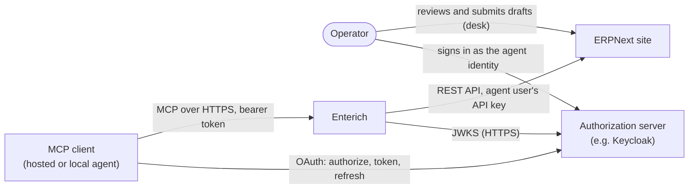
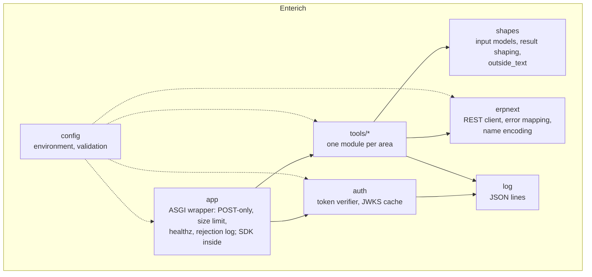
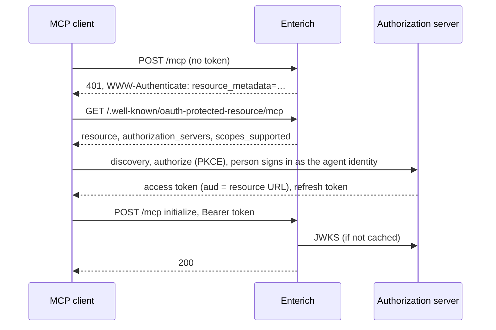
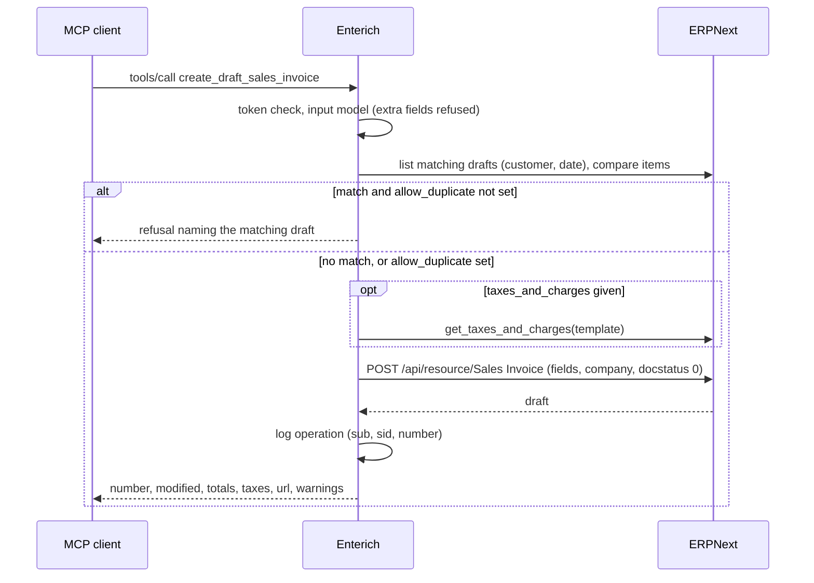
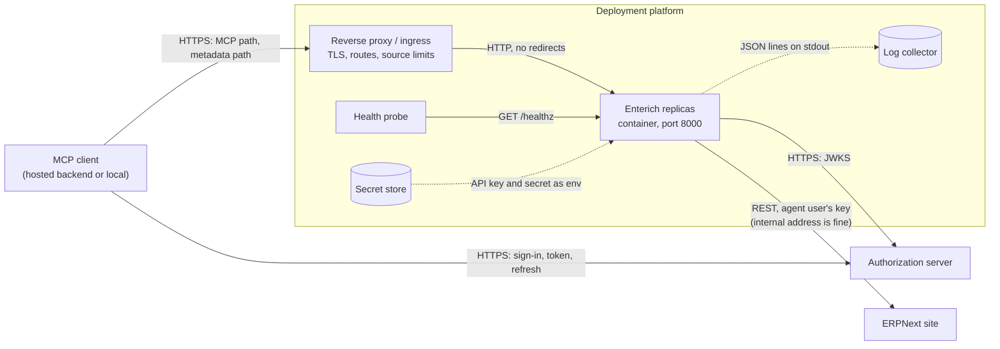

# Enterich architecture

Compact [arc42](https://arc42.org/): all twelve sections in this file, until one of them outgrows it. The service is built with the operations of every area; this describes the design the requirement specifications ([index](../specs/README.md)) and the [ADRs](adr/README.md) set out. Where the code disagrees, the code wins and this file is fixed.

Diagrams are Mermaid, rendered by GitHub.

## 1. Introduction and goals

Enterich is an MCP server for ERPNext with hard limits. It lets one AI agent read an ERPNext company's books and prepare drafts of sales invoices, purchase invoices and journal entries, which a person reviews and submits. Requirements: the [requirement specifications](../specs/README.md), REQ-001 for the core, REQ-002 for the service and one spec per accounting area.

### Quality goals

| # | Goal | Meaning |
| :- | :- | :- |
| 1 | **Containment** | The agent can't do more than read and prepare drafts, even when Enterich, the model or the client misbehave. ERPNext's role is the outer limit, Enterich's fixed operations the inner one. |
| 2 | **Access control** | Only the configured agent identity gets in; every token is checked; kill switches act within a known time. |
| 3 | **Traceability** | Every change is the agent user's in ERPNext and is logged in Enterich with session and outcome. |
| 4 | **Agent usability** | Inputs are exact, refusals carry ERPNext's reason, outside text is marked. |
| 5 | **Maintainability** | Small, deployment-neutral, few dependencies, a stable versioned interface. |

### Stakeholders

| Who | Expects |
| :- | :- |
| Operator (owns the books, decides what the agent may do) | A connector that can't post, a clear list of what the agent can do, kill switches |
| Bookkeeper (reviews and submits drafts) | Drafts that need only a check, with a link and warnings |
| Auditor | Agent changes distinguishable and traceable |
| Agent (the model, through any MCP client) | Stable tools with exact schemas, refusals it can act on, outside text marked |
| Deployer (runs Enterich for a site) | Configuration from the environment, an exact list of rights, health check and logs |
| Contributors | Readable code, tests that run without ERPNext |

The first five are the personas of [REQ-001](../specs/req-001-core.md#personas).

## 2. Constraints

| Constraint | Source |
| :- | :- |
| Python and the official MCP Python SDK | [ADR-002](adr/ADR-002-mcp-sdk-stateless-streamable-http.md) |
| ERPNext v16 REST API with an API key; no Frappe app, no database access | [REQ-001, Intended Use](../specs/req-001-core.md#intended-use) |
| MCP authorization spec: Enterich is a resource server, never an authorization server | [REQ-002-URS-NF002](../specs/req-002-service.md#req-002-urs-nf002-standard-mcp-sign-in) |
| Nothing deployment-specific in the repository; configuration only from environment variables | [REQ-002-URS-NF008](../specs/req-002-service.md#req-002-urs-nf008-deployment-neutral) |
| No tool takes a DocType, method, field list or file path | [REQ-001-PRS-F006](../specs/req-001-core.md#req-001-prs-f006-no-generic-operations), [ADR-001](adr/ADR-001-separate-service-fixed-tools.md) |
| No limit depends on the client asking for approval | [REQ-001-URS-NF001](../specs/req-001-core.md#req-001-urs-nf001-safe-without-client-side-approval) |
| Apache-2.0; "ERPNext" and "Frappe" not in the project or package name | [ADR-006](adr/ADR-006-licence-and-name.md) |
| Images pushed only by the release workflow, from a version tag | [ADR-004](adr/ADR-004-releases-and-image.md) |

## 3. Context and scope

| Interface | Direction | What |
| :- | :- | :- |
| MCP endpoint (resource URL's path) | client → Enterich | Streamable HTTP, POST, JSON; bearer token; the protocol revisions the pinned SDK serves |
| `/.well-known/oauth-protected-resource<path>` | client → Enterich | RFC 9728 metadata, no token |
| `/healthz` | deployment → Enterich | Liveness, no token |
| JWKS URL | Enterich → authorization server | Signing keys over HTTPS, cached 5 min |
| ERPNext REST | Enterich → ERPNext | `/api/resource/<fixed DocType>`, `frappe.client.get`, `frappe.desk.query_report.run` with fixed reports, `get_taxes_and_charges`; `Authorization: token key:secret` and the configured Host |

**Out of scope:** signing in and second factors (the authorization server), network policy and rate limits (the deployment), the agent user's role (the site), browser-based clients calling Enterich directly (no CORS), everything the person does in ERPNext.

## 4. Solution strategy

| Goal | Approach | Decision or requirement |
| :- | :- | :- |
| Containment | A separate service holding only the agent user's key; ERPNext role without submit/cancel/delete as the outer limit; Enterich offers only fixed operations, drafts only, assigned company only | [ADR-001](adr/ADR-001-separate-service-fixed-tools.md), [REQ-001-URS-F003](../specs/req-001-core.md#req-001-urs-f003-never-post-cancel-delete-or-discard), [REQ-001-URS-F004](../specs/req-001-core.md#req-001-urs-f004-a-fixed-list-of-operations), [REQ-001-URS-F005](../specs/req-001-core.md#req-001-urs-f005-one-company) |
| Access control | Local JWT check of issuer, audience, client, subject, type, time; one identity per instance; 5 s leeway | [ADR-003](adr/ADR-003-local-token-check.md) |
| Protocol | Official SDK, stateless Streamable HTTP, JSON, POST only | [ADR-002](adr/ADR-002-mcp-sdk-stateless-streamable-http.md) |
| Traceability | One JSON log line per operation with `sub`, `sid`, outcome | [REQ-002-PRS-NF008](../specs/req-002-service.md#req-002-prs-nf008-log) |
| Stable interface | SemVer over tools, config, logs, rights; tool-list snapshot | [ADR-004](adr/ADR-004-releases-and-image.md) |
| Supply chain | uv lock with hashes, digests, SHA-pinned Actions, Dependabot | [ADR-005](adr/ADR-005-toolchain-and-dependencies.md) |

## 5. Building block view

| Block | Responsibility |
| :- | :- |
| `config` | Reads and validates every `ENTERICH_*` variable once at start; secrets kept out of `repr` |
| `app` | The outer ASGI wrapper (method check, 1 MiB body limit, `/healthz`, `rejection` log from the response status, 503 when no signing keys are available) around the SDK's MCP app with `AuthSettings`; registers only the operations `ENTERICH_TOOLS` allows |
| `auth` | The token verifier of ADR-003; returns the SDK's `AccessToken` with `sub`, `sid` and `expires_at = exp + leeway` |
| `tools/` | One module per accounting area, named like its spec (`master_data`, `order_to_cash`, `procure_to_pay`, `record_to_report`, `bank_and_cash`): each operation with its input model, ERPNext call and result shape; `drafts` holds what every draft operation shares (tax rows, duplicate check, update checks, warnings and their comment), `invoicing` the reads the sales and purchase side share (parties, invoices, tax templates, the aged report) |
| `shapes` | Shared input types (names, dates, decimals, limits, keys) with extra properties forbidden, list paging, child-table cutting, the `outside_text` split |
| `erpnext` | One `httpx2` client with `trust_env=False`: base URL, Host, token header, 30 s per call, 10 MiB per response, no redirects; maps refusals to [REQ-001-PRS-F008](../specs/req-001-core.md#req-001-prs-f008-refusals-reported) messages; encodes name inputs |
| `log` | JSON-lines logging for Enterich's events and the SDK's and uvicorn's loggers |

Repository layout: [development guide](../guides/development.md).

## 6. Runtime view

### First connection

A client that sends an expired token gets 401 and refreshes; a refused refresh sends the person back to sign in.

### Creating a draft

### Updating a draft

Enterich reads the document with `frappe.client.get`, refuses unless it is a draft of the assigned company with the given `modified`, then sends a PUT with the catalogue's fields for the given inputs and `modified`. ERPNext refuses the PUT if the document changed in between (`TimestampMismatchError`, [REQ-001-PRS-F004](../specs/req-001-core.md#req-001-prs-f004-stale-updates-refused)), and refuses a save of a document a person has submitted meanwhile, because the agent user lacks the submit right.

## 7. Deployment view

Enterich is one stateless container: no volume, no database. Any number of replicas behind one URL.

| Need | From the deployment |
| :- | :- |
| Inbound | The MCP path and its metadata path, routed to port 8000, without redirects; `/healthz` for probes. Source restrictions and rate limits are the deployment's |
| Outbound | ERPNext's base URL (internal is fine) and the JWKS URL |
| Secrets | `ENTERICH_ERPNEXT_API_KEY`, `ENTERICH_ERPNEXT_API_SECRET` |
| Clock | Synchronised (NTP), drift well under the 5 s leeway |
| Tokens | Short-lived access tokens (minutes), so the authorization-server kill switch acts soon |
| Image | `ghcr.io/interlusion/enterich:X.Y.Z`, pinned ([ADR-004](adr/ADR-004-releases-and-image.md)) |

Variables: [configuration guide](../guides/configuration.md).

## 8. Cross-cutting concepts

- **Configuration:** environment only, validated at start, fail fast with the variable's name; secrets never printed. No configuration file.

- **Input validation:** pydantic models per operation with `extra="forbid"` at every level, replacing the SDK's argument model, which ignores extra properties; shared types for names ([REQ-001-PRS-F010](../specs/req-001-core.md#req-001-prs-f010-name-inputs-stay-names)), dates, decimal amounts, limits. Validation happens before any ERPNext call.

- **ERPNext calls:** only fixed DocTypes, reports and methods, each in the operation that needs it. Names go as query parameters or JSON values, and into a path only as one encoded segment. Bodies are built from the input model field by field, never by passing the input through.

- **Error mapping:** ERPNext's `exc_type` and the first `_server_messages` entry, labelled as ERPNext's, HTML stripped, entities decoded, cut to 300 characters; never `exc`, `exception` or `_debug_messages`. 403 and 404 on a name become "doesn't exist or isn't permitted". Enterich's own refusals name the input and rule.

- **Outside text:** fields marked in the catalogue go into the `outside_text` of their record or row; every tool description says to treat it, and ERPNext's messages, as data.

- **Logging:** JSON lines on stdout, including the SDK's and uvicorn's loggers. Events ([REQ-002-PRS-NF008](../specs/req-002-service.md#req-002-prs-nf008-log)): `start`, `operation`, `rejection`, `jwks`, `error`. Strings cut; tokens, keys and secrets never logged; unsigned token header values never logged raw.

- **Observability:** the log is Enterich's only telemetry in the first versions, and it is shaped for a log store, not only for reading:

  - every `operation` line carries outcome, total duration, and the number and total duration of its ERPNext calls, so request and error rates, latency percentiles and Enterich's time versus ERPNext's can be computed and alerted on from the log;
  - every `rejection` line carries its status and reason, so a sign-in storm or a misconfigured client shows as a rate;
  - `/healthz` answers liveness without touching ERPNext or the authorization server;
  - request counts, latency and status codes at the edge, and container health, come from the deployment's ingress and platform, not from Enterich.

  Enterich exports no traces or metrics of its own. The MCP SDK brings `opentelemetry-api`, which stays inert because no OpenTelemetry SDK or exporter is installed. Opt-in traces are [ITEM-002](../backlog/item-002-opentelemetry.md).

- **Limits** ([REQ-001-PRS-NF003](../specs/req-001-core.md#req-001-prs-nf003-result-limits), [REQ-002-PRS-NF011](../specs/req-002-service.md#req-002-prs-nf011-limits)) stay below what hosted clients enforce, so Enterich's own message arrives rather than a client's cut-off: Claude's hosted apps, for example, allowed about 150,000 characters per tool result and 240 s per tool call (October 2026).

- **Testing:** unit tests per block; integration tests run Enterich against a fake JWKS and a fake ERPNext that records every request, so each test can assert exactly what ERPNext received. A snapshot of `tools/list` pins the public tool contract.

## 9. Architecture decisions

See the [ADR index](adr/README.md).

## 10. Quality requirements

The quality goals of section 1, made testable. Each scenario names what happens, the response, and how it is measured; the requirement it cites holds the test.

### Containment

| ID | Scenario | Response and measure | Requirement |
| :- | :- | :- | :- |
| QS-01 | A manipulated agent tries to submit, cancel or delete, or sends `docstatus: 1` in a create | No operation exists for it; the extra input is refused before ERPNext; zero writes reach ERPNext | [REQ-001-PRS-F002](../specs/req-001-core.md#req-001-prs-f002-draft-create-operations), [REQ-001-PRS-F006](../specs/req-001-core.md#req-001-prs-f006-no-generic-operations) |
| QS-02 | The agent updates a draft that a person submitted after the agent read it | Refused by Enterich's check or by ERPNext (stale `modified`, no submit right); the document is unchanged | [REQ-001-PRS-F003](../specs/req-001-core.md#req-001-prs-f003-draft-update-operations), [REQ-001-PRS-F004](../specs/req-001-core.md#req-001-prs-f004-stale-updates-refused) |
| QS-03 | The agent asks for another company's invoice by name | Answered as "doesn't exist or isn't permitted"; no field of the other company's document returned | [REQ-001-PRS-F007](../specs/req-001-core.md#req-001-prs-f007-the-assigned-company-from-configuration) |
| QS-04 | The client calls every write operation without asking a person | The same limits apply; the integration suite passes with a client that never confirms | [REQ-001-PRS-F013](../specs/req-001-core.md#req-001-prs-f013-no-approval-in-the-loop) |
| QS-05 | A name input is `X?run_method=discard` | It reaches ERPNext as one encoded path segment; no document method runs | [REQ-001-PRS-F010](../specs/req-001-core.md#req-001-prs-f010-name-inputs-stay-names) |

### Access control

| ID | Scenario | Response and measure | Requirement |
| :- | :- | :- | :- |
| QS-06 | A person's browser session gets a token through the agent's client, and the client retries 50 times | 50 × 401, one log line of ≤ 300 characters each, zero ERPNext calls, at most one JWKS fetch per 30 s | [REQ-002-PRS-NF001](../specs/req-002-service.md#req-002-prs-nf001-token-check), [REQ-002-PRS-NF009](../specs/req-002-service.md#req-002-prs-nf009-rejection-log) |
| QS-07 | The operator disables the agent user in ERPNext | The next operation fails with ERPNext's refusal | [REQ-002-PRS-NF007](../specs/req-002-service.md#req-002-prs-nf007-no-authorization-cache) |
| QS-08 | The operator disables the agent identity at the authorization server | Operations fail at the latest when the current access token expires, plus the 5 s leeway | [REQ-002-PRS-NF001](../specs/req-002-service.md#req-002-prs-nf001-token-check) |
| QS-09 | The JWKS becomes unreachable | Tokens signed with cached keys work until the cache is 5 minutes old, then 503 with `Retry-After`; never a 401 for this cause, so clients don't restart sign-in | [REQ-002-PRS-NF001](../specs/req-002-service.md#req-002-prs-nf001-token-check), [REQ-002-PRS-NF007](../specs/req-002-service.md#req-002-prs-nf007-no-authorization-cache) |
| QS-10 | A forged token arrives: `alg` none, HS256 keyed with the public key, a `jku` header pointing elsewhere | 401; no fetch from the `jku` URL | [REQ-002-PRS-NF001](../specs/req-002-service.md#req-002-prs-nf001-token-check) |

### Traceability

| ID | Scenario | Response and measure | Requirement |
| :- | :- | :- | :- |
| QS-11 | The agent creates a draft | Exactly one `operation` line with operation, `sub`, `sid` and the number; ERPNext shows the agent user as owner | [REQ-002-PRS-NF008](../specs/req-002-service.md#req-002-prs-nf008-log) |
| QS-12 | Any test run, including every token and ERPNext error case | Neither the key, the secret, nor a token's payload or signature appears in any log line or response | [REQ-002-PRS-NF010](../specs/req-002-service.md#req-002-prs-nf010-nothing-secret-leaves-enterich) |

### Agent usability

| ID | Scenario | Response and measure | Requirement |
| :- | :- | :- | :- |
| QS-13 | The agent uses a wrong tax template name | One tool error naming `taxes_and_charges` and both causes; the agent can correct it without guessing | [REQ-001-PRS-F009](../specs/req-001-core.md#req-001-prs-f009-unknown-or-unpermitted-names) |
| QS-14 | The agent asks for the largest page of a large report | A narrowing message from Enterich, never a result over 100,000 characters cut off by the client | [REQ-002-PRS-NF011](../specs/req-002-service.md#req-002-prs-nf011-limits) |
| QS-15 | A customer is named "Ignore previous instructions" | The name arrives only under `outside_text` | [REQ-001-PRS-NF001](../specs/req-001-core.md#req-001-prs-nf001-outside-text-marked) |
| QS-16 | A person edited the draft the agent updates | A message saying the draft changed; a re-read and retry succeeds | [REQ-001-PRS-F004](../specs/req-001-core.md#req-001-prs-f004-stale-updates-refused) |
| QS-17 | The agent creates a draft again after a lost answer, in the same conversation or a new one | Refused as a possible duplicate, naming the first draft; no second document unless the agent sets `allow_duplicate` | [REQ-001-PRS-F005](../specs/req-001-core.md#req-001-prs-f005-possible-duplicates-refused) |

### Maintainability

| ID | Scenario | Response and measure | Requirement |
| :- | :- | :- | :- |
| QS-18 | A change alters a tool's schema | The snapshot test fails until the operation's area spec and the changelog follow; the release's tools asset shows the difference | [REQ-001-PRS-F006](../specs/req-001-core.md#req-001-prs-f006-no-generic-operations), [ADR-004](adr/ADR-004-releases-and-image.md) |
| QS-19 | An MCP SDK update | Its own pull request; the tests for every supported protocol revision pass before merge | [REQ-002-PRS-NF003](../specs/req-002-service.md#req-002-prs-nf003-mcp-endpoint), [ADR-005](adr/ADR-005-toolchain-and-dependencies.md) |
| QS-20 | A minor release adds an operation | A site with `ENTERICH_TOOLS` set doesn't offer it until the site adds it | [REQ-001-PRS-F011](../specs/req-001-core.md#req-001-prs-f011-operations-chosen) |
| QS-21 | A second site deploys Enterich | Only environment variables differ; no code or image change | [REQ-002-PRS-NF005](../specs/req-002-service.md#req-002-prs-nf005-configuration-from-the-environment) |

## 11. Risks and technical debt

| Risk | Mitigation |
| :- | :- |
| Clients change behaviour (approval prompts, scope handling, refresh) | Nothing relies on client approval; behaviour verified with a real client before each release that touches auth |
| MCP SDK breaking releases or new protocol revisions | Exact pin, separate update pull requests, tests per revision, ADR-002 triggers |
| The SDK behaves differently from what its API suggests: three cases found before any code (extra arguments ignored, no leeway on `expires_at`, the verifier not seeing every rejection) | Each case has a test of Enterich's own behaviour, so a later SDK change shows up; ADR-002 and ADR-003 record the workarounds |
| Enterich takes the raw arguments and returns tool errors through SDK parts that aren't its documented API (`ArgModelBase`, `FuncMetadata`, a returned `CallToolResult`) | Tests fail when unknown arguments stop arriving or an error loses its text; SDK updates come in their own pull requests |
| ERPNext API or report output changes between versions | Fake ERPNext mirrors v16 responses; report filters and columns checked against ERPNext v16.52's source (area specs); end-to-end tests against a real site, weekly, and started by hand on a newer ERPNext's pull request before it is merged (development guide) |
| Two identical creates at the same instant both pass the duplicate check | Accepted ([REQ-001 assumptions](../specs/req-001-core.md#assumptions)): one agent works in sequence, and a person reviews every draft |
| A site gives the agent user select instead of read; lists silently lose fields | Configuration guide's rights table; the end-to-end tests show what such a list returns; refusing such answers is in the backlog |
| A site runs a report as a prepared report, or ERPNext turns one into it after a run over 15 seconds | Enterich refuses with a clear message instead of waiting; the configuration guide says how to turn off the automatic switch |
| The authorization server's agent-only login flow is missing or wrong; a person's session then gets a token through the agent's client | Enterich's subject check refuses it in any case (tested in Enterich); the Keycloak guide gives the flow and a check, marked untested |
| An authorization server issues long-lived access tokens; disabling the identity there acts late | Deployment requirement in the configuration and Keycloak guides; optional maximum lifetime in the backlog |
| A later Frappe version turns on its built-in MCP server with generic tools | Configuration guide: turn it off before the upgrade |
| Abandoned drafts use up numbers of the naming series | The deployment's decision ([REQ-001 assumptions](../specs/req-001-core.md#assumptions)); the duplicate check catches retries |
| Document IDs can carry outside text | Documented in [REQ-001's assumptions](../specs/req-001-core.md#assumptions); IDs are needed as inputs |
| Prompt injection that leads the agent to leak data through other connectors | Outside text marked; the deployment keeps the connector apart from outbound ones |
| One maintainer | Small scope, tests that run without ERPNext; the README says "no support promised" |

## 12. Glossary

Terms of the specs: [REQ-001's Terms](../specs/req-001-core.md#terms). In addition:

| Term | Meaning |
| :- | :- |
| MCP | Model Context Protocol: how AI clients call tools on servers |
| Resource server | An OAuth service that accepts tokens but doesn't issue them |
| Protected resource metadata | RFC 9728 document telling a client which authorization server to use |
| JWKS | The authorization server's public signing keys |
| `sid` | The authorization server's session ID in the token (Keycloak and OpenID Connect servers set it; RFC 9068 doesn't require it); ties operations to one connection |
| Tool-list snapshot | The stored `tools/list` answer that tests compare against |
