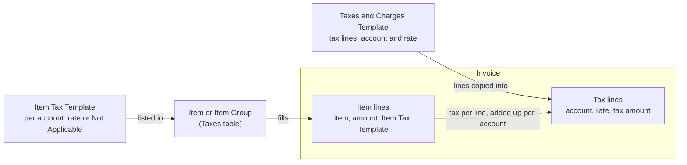
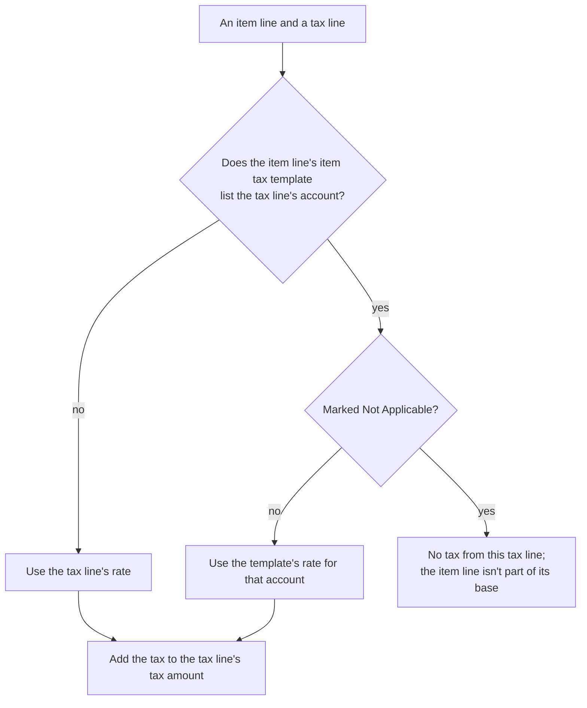
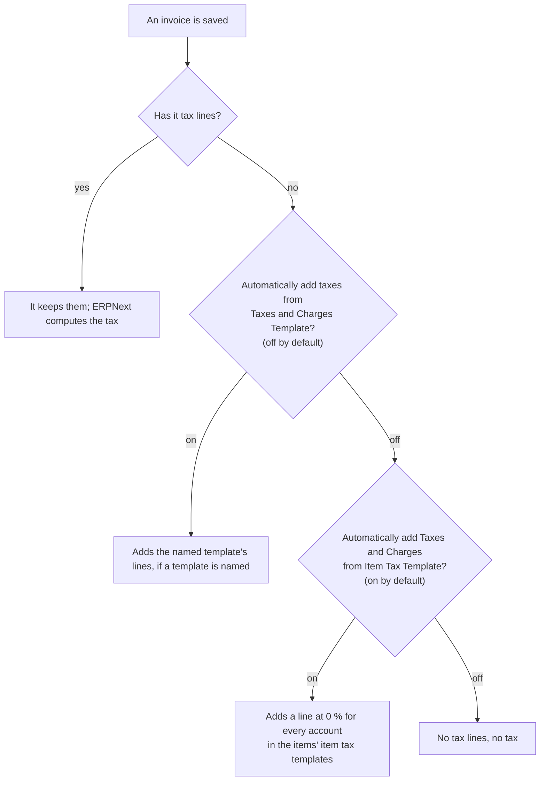
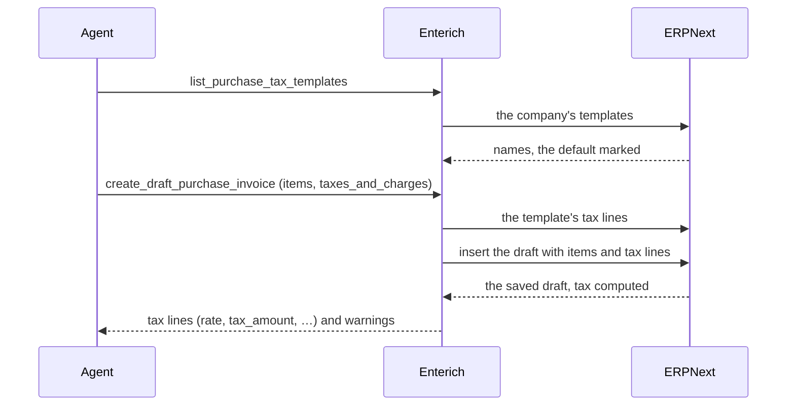

# ERPNext taxes 101

| Meta | Value |
| :- | :- |
| **Date** | 2026-11-07 |
| **Author** | loxy (drafted with Claude) |
| **Status** | Draft: checked against ERPNext v16.52 |

For operators and bookkeepers who set up ERPNext for Enterich's agent, and for anyone puzzled by a tax line that says 0 % but holds 19 € of tax. It explains how ERPNext computes VAT on sales and purchase invoices, why its German setup looks the way it does, how to set up mixed rates cleanly, and what Enterich shows the agent. The examples use the German chart of accounts; the mechanism is the same in every country.

## In short

- An invoice has **item lines** (what is sold or bought) and **tax lines** (one per tax account: the VAT summary).
- ERPNext computes the tax for every pair of item line and tax line. The item line's **item tax template** decides the rate where it lists the tax line's account; otherwise the tax line's own rate applies.
- **One rate per invoice** is the simple form: a tax line at the real rate, items without item tax templates. **Rates per item** is the form for mixed invoices: each item line's item tax template gives its rate.
- ERPNext's German setup uses rates per item with tax lines at **0 %**, so a tax line can show 0 % while holding 19 % of tax. The tax is right; the rate shown is only a fallback.
- ERPNext computes the tax correctly in both forms; Enterich computes none and passes on what ERPNext saved.
- A bill with two rates, such as a hotel's room at 7 % and parking at 19 %, works through Enterich when each rate has its own item. One item at two rates needs the item tax template set on the line, which Enterich's drafts don't take yet.

## The parts of an invoice

- **Item lines** (the Items table): one per thing sold or bought, with its amount. Each has a field **Item Tax Template**, filled from the item (see [below](#the-item-tax-template-on-a-line) for when ERPNext replaces it).
- **Tax lines** (the table **Sales Taxes and Charges** or **Purchase Taxes and Charges**): one per tax account, with a rate and the tax amount. A tax line's amount is the sum of the tax of every item line on it.
- **Tax account**: where the bookkeeping collects one kind of tax. The account belongs to the tax line, not to the item: all items taxed at 19 % put their tax into the one account "Umsatzsteuer 19 %". With one account per rate, as German charts have, the tax lines are the invoice's VAT summary: what is due at 19 %, what at 7 %.
- **Taxes and Charges Template** (Sales or Purchase): a ready-made set of tax lines. The invoice's field **Sales Taxes and Charges Template** (or the purchase one) names it; in ERPNext's form, choosing it fills in its lines.
- **Item Tax Template**: a list of tax accounts, each with a rate or marked **Not Applicable**. An item lists the templates it may be charged at in its **Taxes** table, or inherits them from its Item Group and that group's parents. A row there can be limited by **Tax Category**, **Valid From** (for example for a change of rate on a date) and a minimum or maximum net rate.

Most VAT lines are of the type **On Net Total**: a percentage of the item lines' net amounts. ERPNext has other types too (a fixed amount, a percentage of a previous tax line or its running total, an amount per quantity), used for charges and taxes on taxes rather than plain VAT.

## How ERPNext computes the tax

ERPNext goes through every item line and every tax line:

The tax line keeps the rate it was saved with. ERPNext never writes the rates it used back into the line, so a tax line at 0 % can carry the tax of items taxed at 19 %.

### Example: a hotel bill

A purchase invoice for one night with parking, on the German template "Sonstige Leistung aus dem Inland" (input VAT 19 % and 7 %, both lines at 0 %):

| Item line | Net | Item Tax Template | On "Abziehbare Vorsteuer 19 %" | On "Abziehbare Vorsteuer 7 %" |
| :- | -: | :- | :- | :- |
| Room | 100.00 € | 7 % | Not Applicable | 7 % → 7.00 € |
| Parking | 20.00 € | 19 % | 19 % → 3.80 € | Not Applicable |

The invoice then shows:

| Tax line | Rate shown | Tax amount |
| :- | -: | -: |
| Abziehbare Vorsteuer 19 % | 0 % | 3.80 € |
| Abziehbare Vorsteuer 7 % | 0 % | 7.00 € |

The tax amounts match the hotel's VAT summary (7 % on 100 €, 19 % on 20 €); the rates shown don't. The rates used are on the item lines. In ERPNext's form, the section **Taxes and Charges Calculation** shows them per item. The invoice also stores them in a hidden table, **Item Wise Tax Details** (`item_wise_tax_details`): for each item line and tax line that applies, the rate used, the tax and the taxable amount, in the company's currency, a deducted line's as negative amounts.

## Two ways to set up VAT

### One rate per invoice

A template with one tax line at the real rate, for example "Umsatzsteuer 19 %" at 19 %, and items without an item tax template. Every item line is taxed at 19 %, and the tax line shows 19 %. Another rate needs another template, and an invoice uses one, so one invoice can't mix rates.

### Rates per item

A template with one tax line per rate, and an item tax template on every item line: "19 %" sets the 19 % account to 19 % and the 7 % account to Not Applicable, "7 %" the other way round. One template serves every domestic invoice, whatever its items. ERPNext's German setup puts **0 %** on the template's lines.

The 0 % is a safety net: an item line without an item tax template is taxed at 0 %, which shows as missing tax. The lines could carry their real rates instead, since Not Applicable keeps each item off the other rate's line, and they would then show 19 % and 7 %. The cost: an item line without an item tax template would be taxed at both rates, 26 %.

### Which to use

|  | One rate per invoice | Rates per item |
| :- | :- | :- |
| Mixed rates on one invoice | no | yes |
| Rate shown on the tax line | the real rate | 0 % in the German setup |
| What decides the rate | the invoice's template | each item line's item tax template |
| Setup | one template per rate | a template with a line per rate, item tax templates on the items |
| Suits | sales of one kind, at one rate | purchases, and sales of mixed goods |

A site can use both, chosen per invoice by its template. One rule decides what happens when they meet: **an item line's item tax template wins over the tax line's rate.** On a simple 19 % invoice, an item with the item tax template "19 %" is taxed at 19 %, and one without a template at the line's 19 %. An item with "7 %" gets **no tax at all**: its template excludes the 19 % account (or sets it to 0 % on older templates), and the invoice has no 7 % line. Put such items on the simple form only when every item on the invoice has its rate.

### How other systems do it

Most other accounting systems put a **tax code on each invoice line** ("input VAT 7 %"), which fixes the rate and the account, and group the summary by code. ERPNext's nearest equivalent is the item tax template on each item line. The tax lines then add up what the item lines' templates decided.

## Where the setup comes from

When a company is created, ERPNext's setup wizard creates tax accounts and templates from its country data ([`country_wise_tax.json`](https://github.com/frappe/erpnext/blob/develop/erpnext/setup/setup_wizard/data/country_wise_tax.json)), once. The data differs by country, and so does the form it sets up:

| Country | Statutory rates (2026) | ERPNext's setup creates |
| :- | :- | :- |
| Germany | 19 %, 7 % | templates per kind of transaction, with a line per rate at 0 %, and item tax templates for 19 %, 7 % and 0 %: rates per item |
| France | 20 %, 10 %, 5.5 %, 2.1 % | a sales template per rate, its line at the real rate; purchase templates per rate, also for prices including VAT, and for EU purchases; item tax templates per rate, separate for sales and purchases |
| United Kingdom | 20 %, 5 %, 0 % | "United Kingdom Tax" at 20 %, as a sales, a purchase and an item tax template |
| Netherlands | 21 %, 9 % | VAT 21 % and VAT 6 % (the reduced rate before 2019), each as a sales, a purchase and an item tax template |
| Italy | 22 %, 10 %, 5 %, 4 % | VAT 22 %, 10 % and 4 %, each as a sales, a purchase and an item tax template |

Outside Germany, the tax lines show their real rates, and an invoice picks the template of its rate. Their item tax templates list only their own account, so they don't mix rates on one invoice: on a Dutch 21 % invoice, an item with the item tax template "Netherlands VAT 6%" is still taxed at 21 %, because its template doesn't list the 21 % account. Mixing there needs what Germany's setup has: a template with a line per rate, and item tax templates that mark the other rates Not Applicable. Nothing in these countries' tax law asks for one form or the other; the country data was written by different people at different times. The setup is a starting point: check it against the current rates.

### The German setup

The German data creates nine sales and seven purchase templates, one per kind of transaction: domestic, EU, third country, reverse charge under § 13b UStG, the zero rate under § 12 (3) UStG. For example:

| Template | Side | Tax lines |
| :- | :- | :- |
| Lieferung oder sonstige Leistung im Inland | sales | Umsatzsteuer 19 % and 7 %, both at 0 % (the default) |
| Lieferung an Unternehmen in der EU | sales | none: no German VAT |
| Lieferung aus dem Inland, Sonstige Leistung aus dem Inland | purchase | Abziehbare Vorsteuer 19 % and 7 %, both at 0 % |
| Lieferung aus der EU | purchase | input VAT added and output VAT deducted, for each rate: the tax cancels out |
| Lieferung aus Drittland | purchase | input VAT added, import VAT deducted |

The tax lines carry 0 %, the safety net described above. The item tax templates, named after their rate ("19 %", "7 %", "0 %", spelt slightly differently per chart, with the company's abbreviation appended), list the 13 VAT accounts the setup creates, so the same item works on any invoice:

| Kind of VAT | 19 % | 7 % |
| :- | :- | :- |
| Umsatzsteuer (charged to customers) | ✓ | ✓ |
| Umsatzsteuer aus innergemeinschaftlichem Erwerb (EU purchases) | ✓ | ✓ |
| Umsatzsteuer nach § 13b UStG (reverse charge) | ✓ | ✓ |
| Abziehbare Vorsteuer (paid to suppliers) | ✓ | ✓ |
| Abziehbare Vorsteuer aus innergemeinschaftlichem Erwerb | ✓ | ✓ |
| Abziehbare Vorsteuer nach § 13b UStG | ✓ | ✓ |
| Entstandene Einfuhrumsatzsteuer (import VAT, charged by customs) | one account for both rates |  |

A sales invoice uses only the Umsatzsteuer lines of its template; the item tax template's other entries go unused, unless ERPNext adds lines by itself ([below](#tax-lines-erpnext-adds-by-itself)). Import VAT has one account, as usual in German charts; the item tax template gives its rate. The template "0 %" marks all 13 accounts Not Applicable, for items without VAT.

Since 2026 (ERPNext v16), the item tax templates mark the other rate's accounts **Not Applicable**; before, they set them to 0 %. The tax is the same either way. With 0 %, though, an item counts towards the other rate's line as taxable at 0 %, so the base ERPNext records for each tax line (`net_amount`) mixes both rates. A migration patch sets Not Applicable on existing German companies' templates when the site is migrated (`bench migrate`), but skips templates someone has changed: check those and tick Not Applicable by hand.

## Pitfalls

### The rate shown isn't the rate used

With rates per item, read a tax line's tax amount, not its rate. Enterich's tool descriptions tell the agent the same.

### Tax lines ERPNext adds by itself

When an invoice is saved without tax lines, ERPNext may add some. Accounts Settings has two settings for this, and only one of them can be on:

With the default settings, a draft saved without tax lines gets a line for every account in its items' item tax templates, even when it names a template. With the German templates that is 13 lines, input VAT on a sales invoice among them, 7 of them taxed at 19 %: 266 € of tax on 200 € net. The lines are marked as added from item tax templates and stay through later saves, since ERPNext adds nothing to an invoice that has tax lines.

Avoid it by saving the invoice with its tax lines. In ERPNext's form, choosing the template fills them in. Through the API, they must be sent; Enterich copies the named template's lines into the draft itself. Switching to the other setting makes ERPNext add the named template's lines instead, and an invoice without a template then gets no tax at all.

### No template from the API

ERPNext's form fills in the company's default template and a matching **Tax Rule**'s template. An invoice made through the API gets neither: without a Tax Rule it has no template; with one, ERPNext names the rule's template but adds none of its lines. Enterich therefore asks the agent to name the template.

### The item tax template on a line

On every save, ERPNext checks each item line's item tax template against the item's Taxes table and its Item Groups'. If the item or a group has rows there, and the line's template isn't among those valid for the invoice (its date and Tax Category), ERPNext **replaces it** with the first valid one, with only a message in the form. So:

- An item lists every template it may be charged at: a generic item "Hotel" lists both "7 %" and "19 %". The first valid row is the default for new lines.
- **Tax Category must match exactly.** When an invoice gets a Tax Category (from the party, its address or a Tax Rule), rows without a category no longer count: the line gets no template, and with the German 0 % lines no tax. The German setup creates no tax categories.
- An item without any Taxes rows, in its own table or its groups', keeps whatever template the line names.

### Prices including VAT

Receipts and hotel bills often state gross prices. A tax line with **Is this Tax included in Basic Rate?** ticked treats the item lines' rates as including that tax and computes the net from them. Without it, gross prices entered as rates are taxed a second time.

### Purchases: deducted and valuation lines

A purchase tax line can be set to **Deduct**: its tax amount is positive but subtracted from the total. Reverse charge and EU purchases use this: input VAT added, the same amount of output VAT deducted, no tax to pay the supplier. A purchase tax line of the category **Valuation** puts its tax into the items' value instead of the total, and **Valuation and Total** does both; ERPNext makes either Total when none of the items is a stock or asset item.

## A clean setup for mixed rates

For a German company that buys or sells at both rates:

1. **Item tax templates per rate, the other rate Not Applicable.** Companies set up or migrated since the 2026 change have them, except templates the patch skipped.
2. **Templates with a line per rate**, as the setup creates them, one per side and kind of transaction.
3. **Every rate an item comes at in its Taxes table**, or its Item Group's, the usual one first. Prefer one item per rate where you can ("Übernachtung" with "7 %", "Parken" with "19 %"): the rate then follows from the item alone. Where one item comes at different rates, set the template on the invoice line; ERPNext keeps it only if the item lists it.
4. **Tax lines on every invoice when it is saved**, so ERPNext adds none of its own.
5. **Tax Categories** only if you need them, and then on the item rows too.

For sales at one rate only, the simple form is clearer: a template "Umsatzsteuer 19 %" with its line at 19 %, and sales items without an item tax template.

### Changing the setup later

Templates and item tax templates are ordinary records:

- **Edit** them: rates, lines, Not Applicable.
- **Create** new ones beside the old, and tick **Disabled** on the old instead of deleting them; all three kinds of template have it. ERPNext refuses to delete a template anything links to: invoices, even cancelled ones, items' Taxes rows, Tax Rules.
- **Items**: change their Taxes table, or their Item Group's.

What the change reaches:

- **New invoices** take the new setup.
- **Submitted invoices** keep the tax lines and rates they were submitted with.
- **Drafts** keep their tax lines, but take changed item tax templates at their next save, and ERPNext may then replace a line's template as above.
- A draft whose Taxes and Charges Template was **disabled** can't be saved until it names another one. A disabled item tax template is no longer chosen from the item, and a line's disabled one is replaced at the next save.

## What Enterich shows the agent

- **Inputs:** the invoice drafts take the template (`taxes_and_charges`); `list_sales_tax_templates` and `list_purchase_tax_templates` show the templates and which is the default. An item line takes `item_code`, `qty`, `rate` (the price), `uom`, the account and the cost centre, but no item tax template: its tax rate comes from the item ([REQ-004](../specs/req-004-order-to-cash.md), [REQ-005](../specs/req-005-procure-to-pay.md)).
- **Results:** each tax line with its `rate` and `tax_amount`, on purchases also `add_deduct_tax` and `category`; the descriptions say that `rate` need not be any item's rate ([REQ-001](../specs/req-001-core.md#results)). `get_sales_invoice` and `get_purchase_invoice` give each item line's item tax template; `get_item` gives the item's own Taxes rows, not its group's ([REQ-003](../specs/req-003-master-data.md)).
- **Warnings**, in the result and in the draft's comment ([reviewing drafts](reviewing-drafts.md#enterichs-comments)):
  - a template whose lines all came to zero tax ([REQ-001-PRS-F012](../specs/req-001-core.md#req-001-prs-f012-tax-template-without-tax));
  - tax lines ERPNext added from item tax templates, with their number and tax ([REQ-001-PRS-F020](../specs/req-001-core.md#req-001-prs-f020-tax-rows-from-item-tax-templates));
  - a template ERPNext named from a Tax Rule without its lines ([REQ-001-PRS-F021](../specs/req-001-core.md#req-001-prs-f021-tax-template-without-its-rows)).
- **Not yet:** the item tax template per item line as an input, and a VAT summary per rate in the results. Both are in the [backlog](../backlog/backlog.md).

## Glossary

| German | English | Meaning |
| :- | :- | :- |
| Umsatzsteuer | VAT; output VAT as an account | the tax itself; as an account, VAT charged to customers and owed to the tax office |
| Vorsteuer (abziehbare) | input VAT (deductible) | VAT paid to suppliers, reclaimed from the tax office |
| innergemeinschaftlicher Erwerb | intra-EU acquisition | goods bought from another EU country: the buyer accounts for the VAT |
| § 13b UStG | reverse charge | the buyer owes the VAT instead of the seller |
| Einfuhrumsatzsteuer | import VAT | VAT charged by customs on imports from outside the EU |
| Steuersatz | tax rate | 19 % (standard) or 7 % (reduced) in Germany |

## References

- [REQ-001: Results](../specs/req-001-core.md#results), and its [Assumptions](../specs/req-001-core.md#assumptions) on ERPNext's taxes
- [Reviewing the agent's drafts](reviewing-drafts.md)
- ERPNext source: [`taxes_and_totals.py`](https://github.com/frappe/erpnext/blob/develop/erpnext/controllers/taxes_and_totals.py) (how the tax is computed), [`country_wise_tax.json`](https://github.com/frappe/erpnext/blob/develop/erpnext/setup/setup_wizard/data/country_wise_tax.json) (the setup data)
