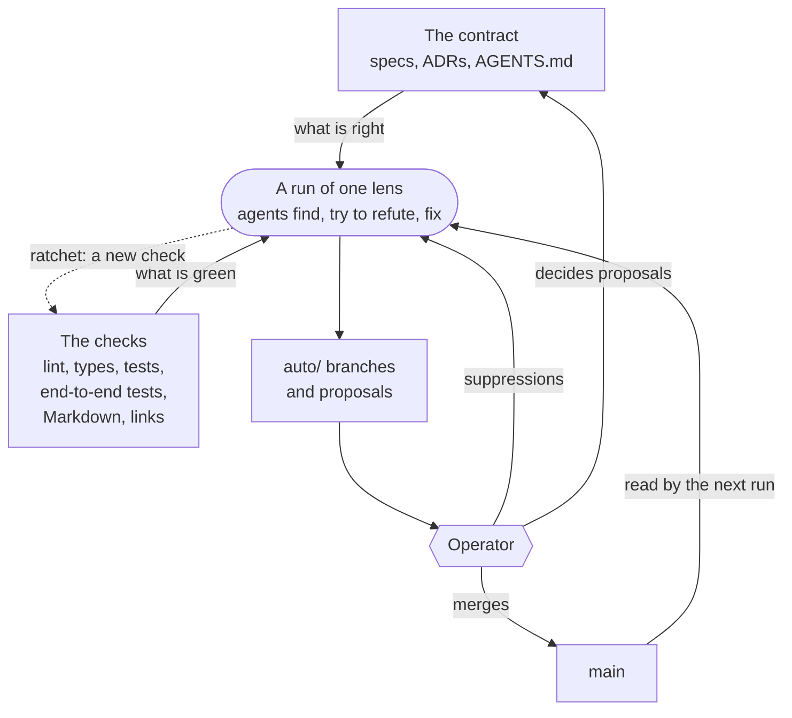
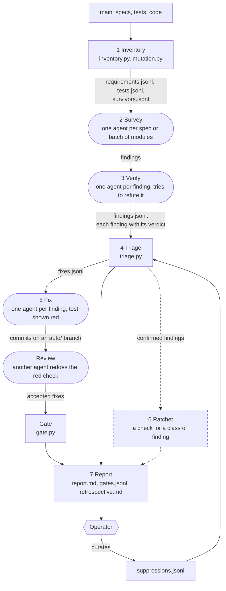
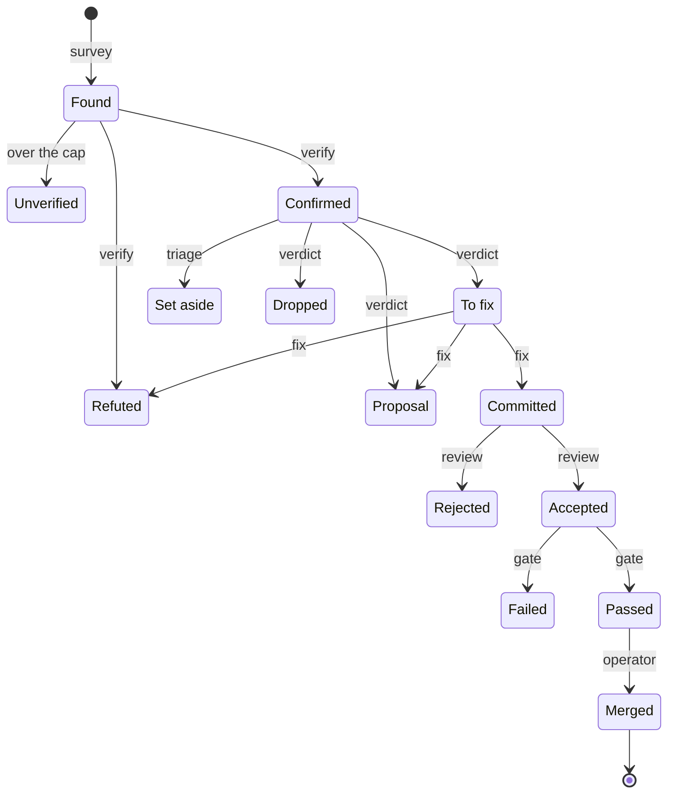
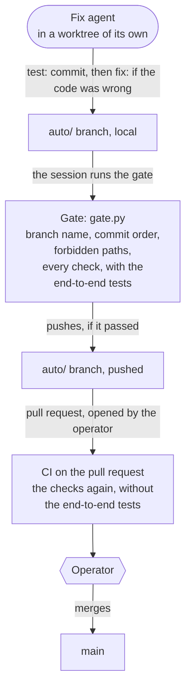
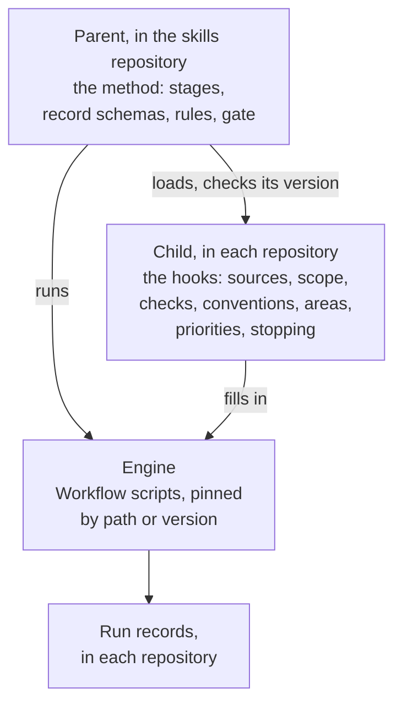

# The improvement pipeline

| Meta | Value |
| :- | :- |
| **Date** | 2026-11-14 |
| **Author** | loxy (drafted with Claude) |
| **Status** | Draft: the pipeline after two runs of the tests lens, with ADR-008 still Proposed |

How the improvement pipeline fits together: the idea, the stages and their records, a finding's way from a survey to `main`, the rules and what checks them, and what isn't built or decided yet. The decision and its rules are in [ADR-008](../arc42/adr/ADR-008-improvement-pipeline.md), the commands in the [harness README](../../harness/README.md), what the first two runs showed in [analysis 002](../analysis/analysis-002-improvement-pipeline-after-two-runs.md).

Diagrams are Mermaid, rendered by GitHub. A rounded box is an agent, a hexagon the operator, a rectangle a script or something in the repository. A dashed border or line means not built.

## The idea

Three kinds of actor, each with one job:

- **Agents judge.** They find, try to refute, and write the fix. Each gets one item, a context of its own and a fixed form for its answer.
- **Scripts decide what counts.** They build the run's universe, check every record, and refuse a branch that breaks a rule.
- **The operator decides what changes.** Only a person merges, and only a person changes the contract.

A run takes one lens (a kind of finding; tests is the only one built) through fixed stages. It ends in `auto/` branches and proposals, never in `main`. Three things flow back so that the next run starts higher: the merged fixes, the operator's suppressions, and checks made from classes of finding (the ratchet).

## Stages and records

The stage numbers are ADR-008's. Mutation testing runs inside Inventory; Review and the gate belong to Fix.

- **Records.** The files named above lie in the run's directory, `harness/runs/<date>-<lens>/`, committed on the run's branch. A run can stop anywhere and go on from its records; the second run did, at the spend limit.
- **Two checks of every record.** The workflow refuses an agent's answer that doesn't match its schema, and triage checks every record again before anything is acted on.
- **Before an agent sees a survivor.** A script sets aside the mutants it can judge itself: a message's wording, a `cast()`'s type text.
- **No driver yet.** The Claude Code session starts each stage, writes the workflow's result to `findings.jsonl`, and drops a fix its review rejected.

## A finding's life

Each arrow names the stage that decides. The exits:

| Exit | When |
| :- | :- |
| Unverified | The survey found more than the run's verify cap; these wait in `unverified.jsonl` for a later run |
| Refuted | The verifier finds a test that already checks it, or the fix agent finds no gap |
| Set aside | The operator's suppressions list it, or an open backlog item tracks it |
| Dropped | Real, but not worth a change |
| Proposal | Closing it needs a change to the contract, or to anything else the pipeline may not change |
| Rejected | The review finds the fix wrong, or wider than the finding |
| Failed | The gate refuses the branch; a finding passes or fails with the others on its branch |

Every exit is counted in the run's records.

## From a fix to `main`

What checks each rule of [ADR-008's Compliance](../arc42/adr/ADR-008-improvement-pipeline.md#compliance):

| Rule | Checked by |
| :- | :- |
| Commits only on `auto/` branches | The gate, by the branch's name; the agents' instructions |
| Nothing the pipeline may not change (the list is `FORBIDDEN` in `harness/gate.py`) | The gate; the review agent |
| A failing test before every change | The gate checks the order of commits. That the test was red, the fix agent shows and the review agent redoes |
| Every check green, the end-to-end tests included | The gate, in a worktree of the branch; CI again on the pull request, without the end-to-end tests |
| A verdict from an agent other than the finding's | The workflow's structure; triage refuses a record without a verdict |
| Every record passes its schema | The workflow, for each agent's answer; triage |
| A test is removed only when the others kill every mutant it kills | Nothing yet; no run removed a test |
| No merge, tag or release | The agents' instructions |

## What makes the next run better

| Loop | Signal | What it changes | State |
| :- | :- | :- | :- |
| A finding | Verdict, red check, review, gate | Whether the finding goes on | Built |
| A run | The universe done, the budget of agents spent, or no new class of finding | When the run stops | The universe is the run's arguments. The workflows take no budget. The records carry no class of finding |
| Between runs | Merged fixes, suppressions, the ratchet's checks | What the next inventory finds | Merged fixes: built. Suppressions: built, none entered yet. Ratchet: not built |
| A lens | Its retrospective: cost, confirmed findings, the operator's sample of merged fixes | The run's parameters, and whether the lens rests | By hand, written twice. The stopping measure is proposed, not decided |
| The method | ADR-008's reconsideration triggers | The decision itself | The first trigger was measured once |

## Method, engine and repository

Three things are interleaved today. The **method** is the stages, the record schemas and the rules. The **engine** is the Workflow scripts in `.claude/workflows/`. The **repository's values** are the paths, the requirement ID pattern, the checks and the forbidden list. The agents' schemas and what they judge by are written in the workflow scripts; the repository's values are constants in the scripts and lines in the prompts.

The end state separates them, and none of the split is built: the method as a parent skill in the skills repository, a child in each repository that fills in named hooks. [Analysis 002, §3.8](../analysis/analysis-002-improvement-pipeline-after-two-runs.md#38-generic-method-and-repository-parts) sorts each part of today's harness into one or the other.

## Open points

| Point | Today | Open |
| :- | :- | :- |
| The ratchet | Stage 6, after Fix, with no script and no agent. The records carry a kind (three values), not a class of finding | Who runs it and on what input, and whether before Fix, so that a class is closed once and not instance by instance ([analysis 002, §3.3](../analysis/analysis-002-improvement-pipeline-after-two-runs.md#33-instances-not-classes)) |
| When a lens rests | Proposed: fewer than one merged fix per ten agents, two runs in a row. A finding takes a verifier, a fixer and a reviewer, so the measure tops out near three and follows the share of findings confirmed | Which measure, and whether the operator's acceptance belongs in it ([analysis 002, §5](../analysis/analysis-002-improvement-pipeline-after-two-runs.md#5-open-questions)) |
| Who sorts fix from proposal | The verifying agent, in its verdict; triage applies the suppressions. Neither run had a proposal | Whether a script or the operator checks that line, and where a behaviour no spec states belongs |
| Where the rules are checked | In the gate, which the session runs. Nothing stops a push that skips it; both runs pushed with `git push` after the gate had passed. CI doesn't check the branch's name, its order of commits or the forbidden paths | Whether those rules also run in CI on a pull request from an `auto/` branch |
| How fixes are grouped | One branch per survey; 7 of 17 conflicted in the second run | By the files a fix touches, in waves ([analysis 002, §3.2](../analysis/analysis-002-improvement-pipeline-after-two-runs.md#32-merge-conflicts-are-a-planning-problem)) |
| Verifying every finding | No cap in the second run; 15 of 172 refuted | Whether every kind of finding needs it |
| What ADR-008 holds | The decision, the rules, and the run's parameters (lens order, grouping, stopping) | Which of these stay in the ADR once it is Accepted, since an Accepted ADR is superseded, not rewritten |
| The driver | The session, by hand | One driver for a run's stages (the pilot's decision 4) |

## References

- [ADR-008](../arc42/adr/ADR-008-improvement-pipeline.md): the decision and its rules
- [Harness README](../../harness/README.md): the commands of each stage, suppressions, keys
- [Analysis 002](../analysis/analysis-002-improvement-pipeline-after-two-runs.md): the pipeline after two runs
- Retrospectives: [the pilot](../../harness/runs/2026-11-12-tests/retrospective.md), [the second run](../../harness/runs/2026-11-12-tests-2/retrospective.md)
- [Development guide](development.md): the steps of a change, which every fix follows
