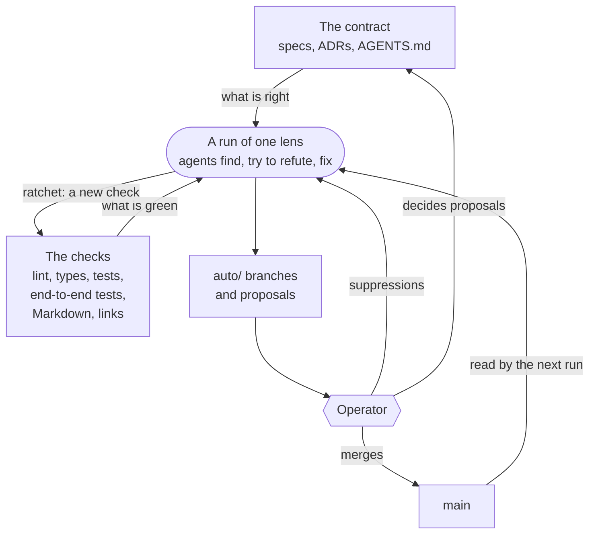
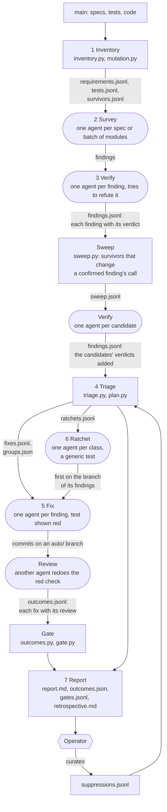
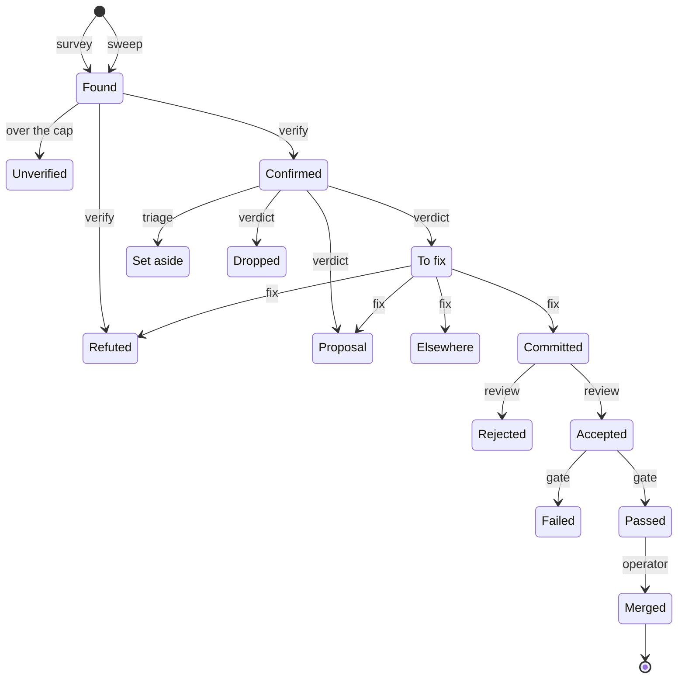
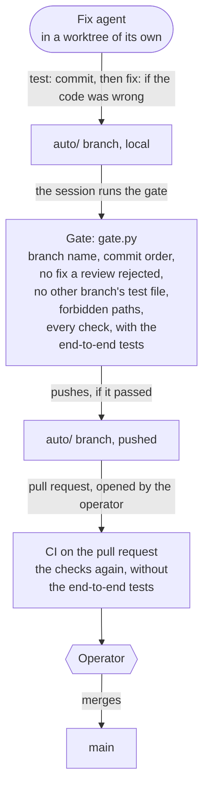
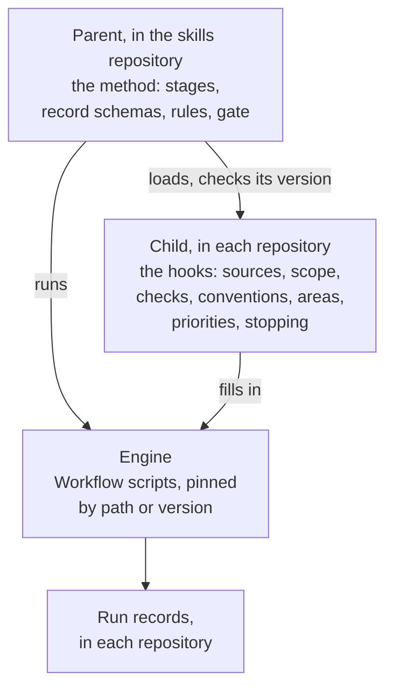

# The improvement pipeline

| Meta | Value |
| :- | :- |
| **Date** | 2026-11-14 |
| **Author** | loxy (drafted with Claude) |
| **Status** | Draft: the pipeline after four runs of the tests lens |

How the improvement pipeline fits together: the idea, the stages and their records, a finding's way from a survey to `main`, the rules and what checks them, and what isn't built or decided yet. The decision and its rules are in [ADR-008](../arc42/adr/ADR-008-improvement-pipeline.md), the commands in the [harness README](../../harness/README.md), what the first two runs showed in [analysis 002](../analysis/analysis-002-improvement-pipeline-after-two-runs.md).

Diagrams are Mermaid, rendered by GitHub. A rounded box is an agent, a hexagon the operator, a rectangle a script or something in the repository.

## The idea

Three kinds of actor, each with one job:

- **Agents judge.** They find, try to refute, and write the fix. Each gets one item, a context of its own and a fixed form for its answer.
- **Scripts decide what counts.** They build the run's universe, check every record, and refuse a branch that breaks a rule.
- **The operator decides what changes.** Only a person merges, and only a person changes the contract.

A run takes one lens (a kind of finding: tests, security and docs are built) through fixed stages. It ends in `auto/` branches and proposals, never in `main`. Three things flow back so that the next run starts higher: the merged fixes, the operator's suppressions, and checks made from classes of finding (the ratchet).

## Stages and records

The stage numbers are ADR-008's. Mutation testing runs inside Inventory; Review and the gate belong to Fix. The ratchet, stage 6 there, runs before its findings' fixes: ADR-008 leaves its place open.

- **Records.** The files named above lie in the run's directory, `harness/runs/<date>-<lens>/`, committed on the run's branch. A run can stop anywhere and go on from its records; the second run did, at the spend limit.
- **A class looked for everywhere.** A survey misses things: in the fourth run it missed the class it had found in two modules in three more. `sweep.py` takes each confirmed mutant gap's changed call of the project's own code and finds the survivors no finding names that change the same one; another run of the survey workflow verifies each place.
- **Two checks of every record.** The workflow refuses an agent's answer that doesn't match its schema, and a script checks every record again before a later stage acts on it: triage the findings, `outcomes.py` the fixes and their reviews.
- **A class is closed once.** A verdict names the finding's pattern, one of the operator's in `harness/patterns.jsonl`, if it has one. Triage makes a ratchet of a pattern that three or more fixes share across at least two files. Its agent writes one generic test for the pattern wherever it can occur, and is reviewed before its findings' agents start; they add only what its test leaves open.
- **Branches that can't conflict in their tests.** A verdict also names the test files its fix will change, and `plan.py` gives each test file to one branch: fixes share a branch when they name a file in common or follow one ratchet. An agent whose test belongs in another branch's file commits nothing and says so, and planning again gives the fix that file; the gate refuses a branch that changed one. Code and `CHANGELOG.md` the plan can't foresee: of two branches gated together that change the same, the gate passes the first and the second waits for its merge.
- **Before an agent sees a survivor.** A script sets aside the mutants it can judge itself: a message's wording, a `cast()`'s type text. What a string is follows from where the function's source sends it, not from what it looks like: only the wording of an error that is raised or of a log message is set aside. A DocType's name, a date's format, a header or a text that goes into a result is a value. Of the fourth run's 183 survivors set aside as wording by their looks, 111 are values by this rule.
- **No driver yet.** The Claude Code session starts each stage, hands each workflow's result to `record.py`, which writes it to the run's records, and drops a fix no review accepted; the gate refuses a branch that still holds one. `cleanup.py` removes the fix agents' worktrees once their commits are on a branch.

## A finding's life

Each arrow names the stage that decides. The exits:

| Exit | When |
| :- | :- |
| Unverified | The survey found more than the run's verify cap; these are listed in `unverified.jsonl`, which no stage reads yet |
| Refuted | The verifier finds a test that already checks it, or the fix agent finds no gap, as when a ratchet's test has closed it |
| Set aside | The operator's suppressions list it, or an open backlog item tracks it |
| Dropped | Real, but not worth a change |
| Proposal | Closing it needs a change to the contract, or to anything else the pipeline may not change |
| Elsewhere | The fix agent finds the test belongs in a test file planned for another branch; the finding stays open for the next run |
| Rejected | The review finds the fix wrong, or wider than the finding |
| Failed | The gate refuses the branch; a finding passes or fails with the others on its branch |

Every exit is in the run's records: those up to triage in `findings.jsonl`, the fix agent's and the review's in `outcomes.jsonl`, the gate's in `gates.jsonl`.

## From a fix to `main`

What checks each rule of [ADR-008's Compliance](../arc42/adr/ADR-008-improvement-pipeline.md#compliance):

| Rule | Checked by |
| :- | :- |
| Commits only on `auto/` branches | The gate, by the branch's name; the agents' instructions |
| Nothing the pipeline may not change (the lists are `FORBIDDEN` and `FORBIDDEN_NAMES` in `harness/gate.py`, the checks' own settings among them), and for the tests lens only tests, code and the changelog (`ALLOWED` there) | The gate, a file moved away at its old place too and each path as it is, whatever its name holds; the review agent |
| A failing test before every change | The gate checks the order of commits, and that a `test:` commit changes only tests. That the test was red, the fix agent shows and the review agent redoes |
| Only reviewed fixes on a branch | The gate lets through only the commits of fixes a review accepted, by hash, or by a diff that is the same to the letter (`git patch-id --verbatim`) |
| Every check green, the end-to-end tests included | The gate, in a worktree of the commit it read, which is the one it pushes, failing the tests if any was skipped, expected to fail or left out; CI again on the pull request, without the end-to-end tests |
| A verdict from an agent other than the finding's | The workflow's structure; triage refuses a record without a verdict |
| Every record passes its schema | The workflow, for each agent's answer; triage and `outcomes.py`, before a later stage reads it |
| A test is removed only when the others kill every mutant it kills | The gate compares the tests that ran and passed with those `main` had where the branch left it, per test function: one that passes in fewer cases (removed, renamed, moved out of pytest's sight, or with a case taken away) fails the branch. Removing a test stays the operator's |
| No merge, tag or release | The agents' instructions |

## What makes the next run better

| Loop | Signal | What it changes | State |
| :- | :- | :- | :- |
| A finding | Verdict, red check, review, gate | Whether the finding goes on | Built |
| A run | The universe done, the budget of agents spent, or no new class of finding | When the run stops | The universe is the run's arguments. With a token target for the turn, the workflows start no verifier and no fix they may not finish; what is left stays unverified or missing. A verdict names a pattern, but nothing counts the new ones |
| Between runs | Merged fixes, suppressions, the ratchet's checks | What the next inventory finds | Merged fixes: built. Suppressions: built, none entered yet. Ratchet: built; the one the third run made was rejected by its review |
| A lens | Its retrospective: cost, confirmed findings, the operator's sample of merged fixes | The run's parameters, and whether the lens rests | By hand, written twice. The stopping measure is proposed, not decided |
| The method | ADR-008's reconsideration triggers | The decision itself | The first trigger was measured once |

## Method, engine and repository

Three things are interleaved today. The **method** is the stages, the record schemas and the rules. The **engine** is the Workflow scripts in `.claude/workflows/`. The **repository's values** are the paths, the requirement ID pattern, the checks and the forbidden list. The agents' schemas and what they judge by are written in the workflow scripts; the repository's values are constants in the scripts and lines in the prompts.

The end state separates them, and none of the split is built: the method as a parent skill in the skills repository, a child in each repository that fills in named hooks. [Analysis 002, §3.8](../analysis/analysis-002-improvement-pipeline-after-two-runs.md#38-generic-method-and-repository-parts) sorts each part of today's harness into one or the other; [analysis 003, §3.6](../analysis/analysis-003-improvement-pipeline-after-three-lenses.md#36-parent-and-child-refreshed) refreshes it after three lenses.

## Open points

| Point | Today | Open |
| :- | :- | :- |
| The ratchet | Built: a pattern in each verdict, a ratchet for one in three or more findings across at least two files, its generic test before its findings' fixes ([analysis 002, §3.3](../analysis/analysis-002-improvement-pipeline-after-two-runs.md#33-instances-not-classes)). The third run made one, at the threshold of two locations it had then, from two neighbouring findings in one module; its review rejected the test. The threshold was raised after it and its pattern, `limit-not-at-boundary`, left the vocabulary; `plan.py` run again plans a rejected ratchet's findings as fixes of their own. The fourth run made none: two findings shared `refusal-by-prefix`, and a third of the same class, in a warning, named no pattern. The pattern was widened after it as `text-by-part`; the run's survey had missed the same class in three more modules. Since then `harness/sweep.py` looks for a confirmed finding's class in every survivor: the survivors no finding names that change the same call of the project's own code, verified by the survey workflow run again | Whether the threshold and the three patterns left hold in a run: no ratchet has been accepted yet. A class no pattern names shows only in reading the findings. A check outside the tests, such as a lint rule, stays a proposal |
| When a lens rests | Proposed: fewer than one merged fix per ten agents, two runs in a row. A finding takes a verifier, a fixer and a reviewer, so the measure tops out near three and follows the share of findings confirmed | Which measure, and whether the operator's acceptance belongs in it ([analysis 002, §5](../analysis/analysis-002-improvement-pipeline-after-two-runs.md#5-open-questions)) |
| Who sorts fix from proposal | The verifying agent, in its verdict; triage applies the suppressions. Neither run had a proposal | Whether a script or the operator checks that line, and where a behaviour no spec states belongs |
| Where the rules are checked | In the gate, which the session runs. The first two runs pushed with `git push` after the gate had passed; the third pushed through the gate, which pushes a branch that passed earlier without a second run of the checks, so pushing past it saves nothing, but nothing stops it either. CI doesn't check the branch's name, its order of commits or the forbidden paths | Whether those rules also run in CI on a pull request from an `auto/` branch |
| How fixes are grouped | Built: by the test files the verdicts name, one branch per file or set of files that fixes tie together. In the third run all three commits changed exactly the file their verdict named, on two branches that shared none. In the second run 139 of 145 merged fixes changed one file, and the finding's own text named it for 134 of 137; the inventory's citations would have named it for 96 of 145 | Whether verdicts name the files that well in a large run. A fix that crosses many files, or a ratchet, ties them into one long branch: by the files the second run's fixes changed, the longest would hold 50 of 145. Changes to `src/` and `CHANGELOG.md` aren't planned. Waves and a rebase before the gate ([analysis 002, §3.2](../analysis/analysis-002-improvement-pipeline-after-two-runs.md#32-merge-conflicts-are-a-planning-problem)) aren't built |
| Verifying every finding | No cap in the second run; 15 of 172 refuted | Whether every kind of finding needs it |
| What a change to the flow costs | ADR-008 is Accepted, so it is superseded, not rewritten. It fixes the stages, the rules, the lens order and when a run stops; it leaves open the ratchet's place, how fixes are grouped, the verify cap and the measure for a lens | Which of the fixed parts should move out of the ADR when it is next superseded |
| One fact in several places | The forbidden list is in ADR-008, `harness/gate.py` and the fix workflow's prompt; a test holds the prompt's list of what a fix may change to the gate's. The key of a finding is computed in `harness/triage.py` and in the survey workflow, and no test holds those equal | One source, or a test that compares them, for the key too |
| The driver | The session, by hand: it starts each script and workflow in turn and drops what no review accepted. `record.py` writes the workflows' results to the run's records, and `plan.py` run again plans what a fix stage left | One driver for a run's stages (the pilot's decision 4) |

## References

- [ADR-008](../arc42/adr/ADR-008-improvement-pipeline.md): the decision and its rules
- [Harness README](../../harness/README.md): the commands of each stage, suppressions, keys
- [Analysis 002](../analysis/analysis-002-improvement-pipeline-after-two-runs.md): the pipeline after two runs
- [Analysis 003](../analysis/analysis-003-improvement-pipeline-after-three-lenses.md): the pipeline after three lenses, and what to prepare for the parent and child skills
- Retrospectives: [the pilot](../../harness/runs/2026-11-12-tests/retrospective.md), [the second run](../../harness/runs/2026-11-12-tests-2/retrospective.md), [the third run](../../harness/runs/2026-11-14-tests/retrospective.md), [the fourth run](../../harness/runs/2026-11-14-tests-2/retrospective.md)
- [Development guide](development.md): the steps of a change, which every fix follows
